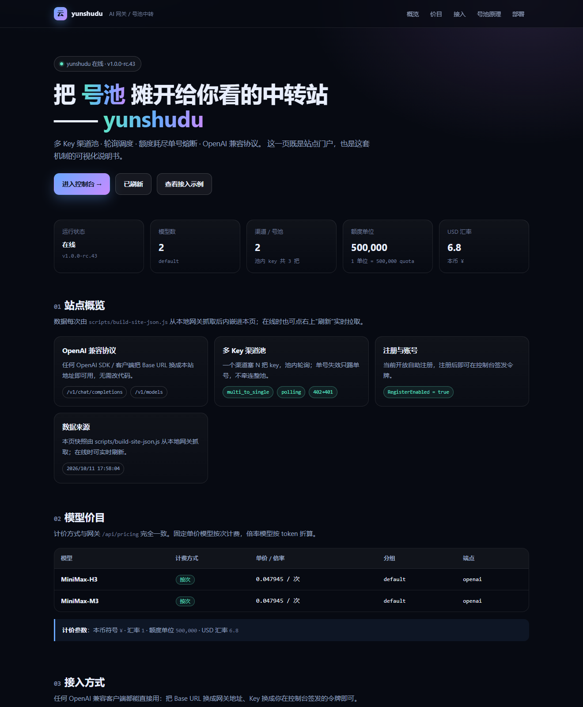

# yunshudu · 自建 AI 中转站（号池 / 算力池）落地套件

> **仓库名 = 站名**：yunshudu。一套免 Docker、自带网页版门户的 AI API 中转站。

> 一套 **免 Docker、纯 Windows、开箱即跑** 的 AI 中转站（API 网关）本地环境。
> 目的是把 `ifrogai.token6688.com` / `xuetianai.com` / `45.207.214.163:3000` 这类站点
> **公开可验证的架构**在本地等价复现出来，用来验证"多 Key 渠道池 / 号池轮询 / 额度耗尽熔断"
> 到底是**怎么实现的**，而不是停留在听说。

---

## 0. 一句话结论（先说结论）

这些站**没有私有魔法代码**。它们全部构建在开源主干上：

| 层 | 项目 | 许可证 | 作用 |
|---|---|---|---|
| 网关前台 + 计费 + 渠道池 | [`QuantumNous/new-api`](https://github.com/QuantumNous/new-api) | AGPL-3.0 | 令牌、计价、渠道、优先级/权重、多 Key 池、自动封禁 |
| Google 账号池引擎（雪天那条线） | [`TheSmallHanCat/flow2api`](https://github.com/TheSmallHanCat/flow2api) | MIT | 账号额度调度、Token 刷新、限流退避 |

铁证（可自行验证）：
1. 雪天与 `:3000` 的 `GET /api/pricing` 都返回同一个 `pricing_version`：
   `5a90f2b86c08bd983a9a2e6d66c255f4eaef9c4bc934386d2b6ae84ef0ff1f1f`
   —— 该字符串在 new-api `model/pricing.go` 里是**硬编码常量**。
2. 雪天前端 bundle 里挖出的"独家功能名"（Channel Affinity / Codex Account & Usage / Apply All Upstream Updates / Prefill Group …），
   在 new-api 的 `web/src/i18n/locales/en.json`（7,253 键）中**逐条命中**；对照组 Veloera 0/10。
3. 版本号 `dev-sdbill-20260929` 是**站主自编译 tag**（仓库 `VERSION` 为空，靠 `VITE_REACT_APP_VERSION` 注入）。

本站就是把第 1 行的网关在本地原样跑起来，并把"池"的行为做成可观测实验。

---

## 1. 依赖

| 需要 | 版本 | 说明 |
|---|---|---|
| Windows | 10/11 x64 | 目标机实测可用 |
| PowerShell | 5.1+ | 系统自带 |
| Node.js | ≥ 18（实测 v24.21.0） | **可选**，仅用于跑 `scripts\*.js` 演示脚本；new-api 本体是 Go 单文件 exe，不需要 Node |
| Docker | **不需要** | 本方案专门走免 Docker 路线 |

磁盘占用：`runtime\bin\new-api.exe` ≈ 131 MB，其余忽略不计。

---

## 1.5 网页版门户（`web/`）

仓库自带一个**纯静态单页门户**，不需要构建、不需要 npm：

```powershell
node .\scripts\build-site-json.js    # 抓本地网关数据 -> web/data/site.json，并内嵌进 index.html
node .\scripts\serve-web.js          # 起门户：http://127.0.0.1:8899
# 或后台起
powershell -ExecutionPolicy Bypass -File .\scripts\start-web.ps1
```

| 特性 | 说明 |
|---|---|
| 双模数据 | 页面内嵌快照（**双击 index.html 离线也能看**）+ 在线时自动 `fetch` 实时刷新 |
| 同源代理 | `serve-web.js` 把 `/api/*`、`/v1/*` 反代到 `127.0.0.1:3300`，绕开浏览器跨域 |
| 内容 | 站点概览 / 模型价目表（含按次·按量标签）/ 四种语言接入示例（可一键复制）/ 号池原理四步图 / 渠道池实况表 / 部署指引 |
| 部署 | `web/` 是纯静态目录：丢到任意静态托管（GitHub Pages、Cloudflare Pages、nginx）即可 |




> 仓库存的是**门户源码**；站点的"真身"是 new-api 网关（它是完整的管理前台 + API）。

### 在线地址（GitHub Pages）

```text
https://zhouxiaojin168.github.io/yunshudu/
```

仓库转 public 后由 `.github/workflows/pages.yml` 自动部署 `web/` 目录。

线上页面连不上本地网关，所以显示的是**内嵌快照**。要让它实时拉数据，
把 `web/index.html` 里的 `window.__API_BASE__` 填成你的**公网 https 网关地址**即可：

```html
<script>window.__API_BASE__ = 'https://你的网关域名';</script>
```
> 门户负责品牌、价目、接入文档与机制展示。

---

## 2. 跑起来（一键 · 或手动分步）

### 2.0 懒人版：一条命令

```powershell
cd E:\中转站测试\newapi-relay-stack
powershell -ExecutionPolicy Bypass -File .\scripts\start-all.ps1
```

它会依次做 8 步（下载二进制 → 起网关 → 初始化 → 起模拟上游 → 建渠道池 → 写计价 → 修正令牌明文 → 4 次冒烟），
幂等可重复执行。下面是想手动分步时看的。

### 2.1 手动三步

```powershell
cd E:\中转站测试\newapi-relay-stack

# ① 下载官方预编译 + SHA256 校验（已下载过会秒过；带 curl -C - 断点续传）
powershell -ExecutionPolicy Bypass -File .\scripts\download-release.ps1

# ② 启动网关（默认端口 3300，日志进 runtime\logs）
powershell -ExecutionPolicy Bypass -File .\scripts\start-local-windows.ps1

# ③ 初始化 root + 写入站点参数（站名/注册开关/计价单位/汇率）
node .\scripts\bootstrap-local.js
```

跑完后打开 <http://127.0.0.1:3300>，账号密码在 `runtime\credentials.txt`。

> ⚠️ `runtime\credentials.txt` 含 root 密码与 access_token，**已在 .gitignore 中，切勿外传**。

### 2.2 起"上游号池"实验环境（手动分步版）

```powershell
powershell -ExecutionPolicy Bypass -File .\scripts\start-mock-pool.ps1   # 9921 健康池 / 9922 欠费池
node .\scripts\setup-channels.js                                          # 建"多 Key 渠道池"渠道 + 测试令牌
node .\scripts\set-pricing.js                                             # 配 MiniMax-H3/M3 计价（否则报 model_price_error）
node .\scripts\test-call.js 20                                            # 端到端压测，观察轮询与熔断
```

---

## 3. 实测结果（可直接复现）

`node .\scripts\test-call.js 20` 输出（节选）：

```
call#1..3   HTTP 401  {"message":"insufficient balance", ...}      <- 打到 B 组（欠费池）
call#4      HTTP 200  [UPSTREAM-A(healthy)] served key=sk-a1 (1/2) <- 轮询到 sk-a1
call#5      HTTP 200  [UPSTREAM-A(healthy)] served key=sk-a2 (1/2) <- 轮询到 sk-a2
call#6      HTTP 200  [UPSTREAM-A(healthy)] served key=sk-a1 (2/2) <- sk-a1 第二格额度
call#8      HTTP 200  [UPSTREAM-A(healthy)] served key=sk-a2 (2/2) <- sk-a2 第二格额度
call#9..20  HTTP 401  {"message":"insufficient balance", ...}      <- 两把 key 都耗尽
```

对应的 mock 上游逐请求日志（`runtime\logs\mock-pool.out.log`）证明
**4 次成功 = 2 把 key × 每把 2 格额度，一格不多**：

```
[mock][B] key=sk-b1  used=0/0  -> 402 insufficient balance
[mock][A] key=sk-a1  used=1/2  -> 200 (MiniMax-H3)
[mock][A] key=sk-a2  used=1/2  -> 200 (MiniMax-H3)
[mock][A] key=sk-a1  used=2/2  -> 200 (MiniMax-H3)
[mock][A] key=sk-a2  used=2/2  -> 200 (MiniMax-H3)
[mock][A] key=sk-a1  used=2/2  -> 402 insufficient balance   <- 熔断后仍在池里，但已无额度
```

**这就把"算力池"的黑箱打开了**：所谓"无限算力/无限号池"= 一批额度有限的 key 排队轮询，
池子空了就报错，池子续上就继续——本质是**供给调度**，不是无限。

---

## 4. 原理：两层池

### 池① 多 Key 渠道池（`:3000` 用的是这层）

new-api 的 `channels` 表里，`key` 字段**允许用换行 `\n` 塞多个 key**，于是"一个渠道 = 一个号池"。

| 环节 | 源码位置（new-api 主干） | 行为 |
|---|---|---|
| 建池 | `controller/channel.go` | 建渠道必须 `mode: "multi_to_single"`，否则建出来 `multi_key=false` |
| 取号 | `model/channel.go` `GetNextEnabledKey()` | 按 `multi_key_mode` 轮询（`polling`）或随机（`random`）取下一把 key |
| 单号熔断 | `handlerMultiKeyUpdate()` | 某把 key 被判定失效 → 只把**这一把**踢掉，其余继续用 |
| 整池熔断 | 同上 + `auto_ban` | 池里 key 全灭 → 渠道 `AutoDisabled`，等上游活过来再自动启用 |

**关键一行**（整条链路的灵魂）：

```
status_code_mapping = {"402":"401"}
```

上游额度耗尽返回 `402 insufficient balance`；站点把它**改写成 `401`（认证失败）**。
配合 `auto_ban=1`，结果就是：**只封这一把 key，轮询自动换下一个号**。
如果不做这个映射，`402` 会被当成渠道级故障，整池一起挂——这就是很多站"一挂全挂"的原因。

其它实测参数：

| 参数 | 值 | 含义 |
|---|---|---|
| `priority` | 5 | 越小越优先 |
| `weight` | 10 | 同优先级内按权重随机 |
| `auto_ban` | 1 | 失败自动封禁 |
| `group` | `default` | 分组（不同分组可给不同价格） |
| `type` | 1 | OpenAI 兼容协议 |

### 池② Google 账号池（雪天用的是这层，flow2api）

| 机制 | 行为 |
|---|---|
| `Token` 表 | `st/at/at_expires/credits/user_paygate_tier/image_enabled/video_enabled/proxy_url/ban_reason` |
| AT 刷新 | access token 剩余 < 1h 自动刷新 |
| 限流退避 | `429` **只封 12 小时**，到点自动解禁 |
| 白名单 | 瞬时错误（网络抖动等）不杀号 |
| 调度排序 | `(needs_refresh, inflight, has_limit, -remaining, random)` —— 先刷新的、在途少的、有限额的、余额多的优先 |

---

## 5. 目录结构

```
newapi-relay-stack\
├─ README.md                      你正在看的这份
├─ .gitignore                     已屏蔽 runtime 产物 / exe / 凭据
├─ web\                            ★ 网页版门户（纯静态，可直接托管）
│  ├─ index.html                  单页门户：概览 / 价目 / 接入 / 号池原理 / 部署
│  ├─ styles.css
│  ├─ app.js
│  └─ data\site.json              数据快照（build-site-json.js 生成，并内嵌进 index.html）
├─ docs\
│  └─ 本地落地实录.md              本轮实测取证（含 401 排查过程）
├─ config\                        （留空，站点参数由 bootstrap-local.js 写入 SQLite）
├─ runtime\                       ★ 全部为运行期产物，不入库
│  ├─ bin\new-api.exe             官方预编译（download-release.ps1 自动下载）
│  ├─ data\one-api.db             SQLite：options/channels/tokens/logs…
│  ├─ logs\                       new-api 与 mock 上游日志、pid
│  ├─ checksums-windows.txt       官方 SHA256
│  ├─ credentials.txt             root 账号密码 + access_token（勿外传）
│  └─ test-token.txt              测试令牌明文（脚本自动写）
└─ scripts\
   ├─ download-release.ps1        下载 + SHA256 校验
   ├─ start-local-windows.ps1     免 Docker 启动网关
   ├─ bootstrap-local.js          初始化 root + 写站点参数
   ├─ start-all.ps1              一键全流程（下载+起服+建池+计价+冒烟，幂等）
   ├─ start-mock-pool.ps1        起模拟上游
   ├─ mock-pool.js                模拟上游：9921 健康池 / 9922 欠费池（带逐请求日志）
   ├─ setup-channels.js           幂等创建"多 Key 渠道池"渠道 + 测试令牌
   ├─ set-pricing.js              写 ModelPrice/ModelRatio/CompletionRatio
   ├─ set-site.js                 登录 + 写站名等站点参数
   ├─ login.js                    刷新 access_token（JWT 过期时用）
   ├─ build-site-json.js          抓网关数据 -> web/data/site.json 并内嵌进 index.html
   ├─ serve-web.js                网页门户服务器 8899 + /api 反代
   ├─ start-web.ps1               后台起网页门户
   ├─ show-tokens.js              从 SQLite 读令牌明文（接口只返回脱敏值）
   └─ test-call.js                端到端压测
```

---

## 5.5 自动同步到 GitHub（auto-sync）

改完本地文件不用手动推，两种方式：

```powershell
# ① 实时监听（推荐）：文件一变，防抖 8 秒后自动 commit + push
powershell -ExecutionPolicy Bypass -File .\scripts\start-autosync.ps1
powershell -ExecutionPolicy Bypass -File .\scripts\stop-autosync.ps1     # 停

# ② 计划任务兜底（每 10 分钟一次，重启也不怕）
powershell -ExecutionPolicy Bypass -File .\scripts\install-autosync-task.ps1
powershell -ExecutionPolicy Bypass -File .\scripts\install-autosync-task.ps1 -Uninstall
```

`scripts\auto-sync.js` 每次同步的流程：

```
重建网页快照 -> git add -A -> 没变化就跳过
            -> 敏感信息自检（命中就中止，不提交不推送）
            -> git commit -> git push
```

- 日志：`runtime\logs\auto-sync.log`
- **token 只放仓库外**：`$env:CODEX_HOME\work\tools\gh-token.json`（或环境变量 `GITHUB_TOKEN`），**绝不写进仓库**
- 敏感自检会拦下 `sk-xxx` / JWT / `password:` / 私钥，并且 `runtime/github-token.txt`、`runtime/credentials.txt`、`runtime/test-token.txt` 三个文件**永远拒绝入库**（双保险）
- 推送后 GitHub Pages 会自动重新部署，约 1 分钟生效

---
## 6. 踩过的坑（照抄能省 2 小时）

1. **建渠道的 `mode` 必须是 `multi_to_single`**。用 `single` 建出来 `multi_key=false`，池子静默失效。
2. **key 用换行 `\n` 拼接**，不是 JSON 字符串。
3. `GET /api/channel/?p=0` 返回的是 `{data:{items:[...]}}` **不是数组**，脚本要取 `.data.items`；`/api/token` 同理。
4. **`/api/token` 接口返回的 key 是脱敏的**（`sk-OY6x**********YfRF`）。拿它去调 `/v1/*` 必然 **401 Invalid token**。
   要真明文只能读 SQLite `tokens` 表 —— `scripts\show-tokens.js` 就是干这个的。
5. 请求时报 `model_price_error`：模型没配价。跑 `scripts\set-pricing.js`，或在后台"系统设置 → 分组与模型定价"里配。
6. new-api 读的库文件是 `one-api.db`（名字沿用历史），有 `-wal` 时注意 WAL 未 checkpoint，直接读可能拿到旧值。
7. 本机 `git` 不在 PATH：用全路径 `E:\git\Git\cmd\git.exe`。

---

## 7. 合规与边界

- 本仓库只做**公开源码 + 本地自建**，不含任何目标站的私有内容。
- `scripts\mock-pool.js` 是**自己写的假上游**，不发任何外部请求。
- 请勿把本环境的 `credentials.txt` / `test-token.txt` 提交到公开仓库。
- 用别人的模型额度（"薅羊毛"）涉及上游 ToS 与法律风险，本仓库**只做机制复现与技术验证**，不为该用途背书。